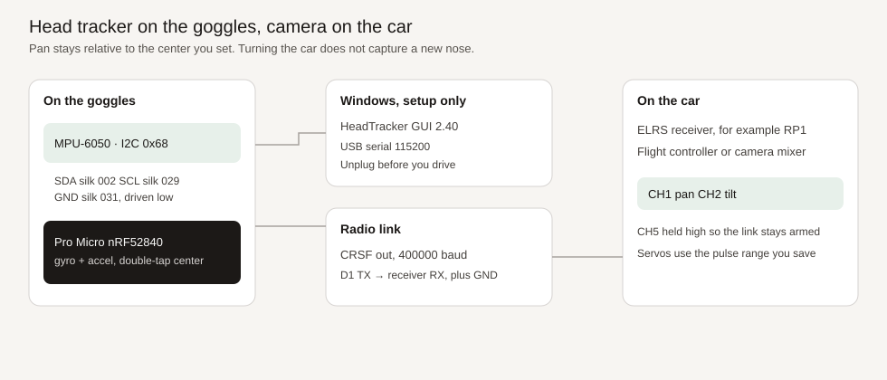
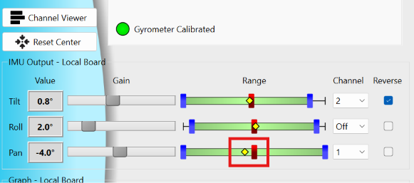

# Pro Micro nRF52840 head tracker

A head tracker for FPV goggles. An MPU-6050 on a Pro Micro nRF52840 reads your head and sends **pan** and **tilt** as CRSF channel data to an ExpressLRS receiver. The camera servos follow your head. Turning the car does not steal the center.

The USB port speaks the same settings protocol as [HeadTracker GUI 2.40](https://github.com/headtracker/HeadTracker), so channels, gain, and servo travel are set from Windows. The GUI is only needed while you configure. Driving does not need a PC.

This firmware is a separate program for the stacked Pro Micro + MPU board. It is not a copy of the official HeadTracker sources. The GUI itself stays in that project.



## What it is for

People building a goggle head tracker keep hitting the same walls:

- After a few looks to one side, pan does not come back to the nose.
- When the car or plane yaws, a compass-based tracker treats that as a head turn and the camera stays looking sideways.
- Recentering needs a button, and drilling the goggles is awkward.
- CRSF never locks because the UART is left at 460800 instead of the 400000 ExpressLRS expects.
- The servo only uses part of its travel.

This build addresses those. Pan is the gyro integral from the moment you center. Tilt and roll are leveled from gravity, and that correction is not allowed to walk the pan. A double tap on the goggles sets a new center. The CRSF UART is stopped and programmed to 400000 baud before any frame is sent.

## Flash it on Windows

You do not need to compile anything to try the firmware.

1. Hold the Pro Micro reset button, tap it a second time, and release. A USB drive appears (often named `NICENANO` or similar).
2. Copy [`promicro-headtracker.uf2`](promicro-headtracker.uf2) onto that drive.
3. The board reboots and the drive disappears. That is the flash finishing.
4. Watch the LED:
   - one short blink each second: the IMU is not answering on I2C
   - fast blink: hold the goggles still, the gyro is learning its bias
   - solid: ready

Bootloader note: this UF2 targets a UF2 0.6.0 bootloader with SoftDevice S140, application start `0x26000`. Do not update that bootloader first.

### Set it up in the GUI

1. Install [HeadTracker GUI 2.40](https://github.com/headtracker/HeadTracker/releases) for Windows. This repository does not include that program.
2. Plug the board in over USB and press Connect. It identifies itself so the existing GUI will open it. The COM number is whatever Windows assigns on your PC. Nothing in this repo is tied to one port.
3. In the UART tab set mode to **CRSF out**. Leave hardware invert off. This clone has no inverter, and the firmware transmits a normal UART either way.
4. Suggested starting point, then **Save Settings**:

   | Axis | Channel | Gain | Center | Min | Max |
   | --- | --- | --- | --- | --- | --- |
   | Pan | 1 | 5 | 1500 | 1000 | 2000 |
   | Tilt | 2 | 5 | 1500 | 1000 | 2000 |
   | Roll | Off |  |  |  |  |

   Gain `5` maps about ±90° of head movement onto that pulse range. If a servo still stops early, widen min and max toward the ends of that servo, then save again. If it buzzes at the end stop, narrow the range back.
5. On the General tab, enable **Reset on double tap**. Two firm taps on the goggles, with a short gap (about 100–400 ms), recenter pan, tilt, and roll. A short press of a button from **D2** to GND does the same thing. There is also **Reset Center** in the GUI.
6. Unplug USB before you drive. The tracker keeps running from the goggles supply.

The link sends channel 5 high so a receiver that treats channel 5 as arm stays armed. Pan is channel 1 and tilt is channel 2, counting from 1 as the GUI does.

On the receiver, UART inverted must be **off** and the port must be CRSF at 400000. A port left at 460800 will never lock, and the car will show no head-tracker channels.

## Wiring

The IMU is the small board stacked on the Pro Micro. From the regulator side the sensor pins are VCC, GND, SCL, SDA. The firmware already holds the GND pin low, so that stacked ground works without an extra wire.

| Pro Micro silk / Arduino | nRF pin | Connects to |
| --- | --- | --- |
| 002 / A2 | P0.02 | MPU SDA |
| 029 / A1 | P0.29 | MPU SCL |
| 031 / A0 | P0.31 | MPU GND, driven low |
| D1 | P0.06 | Receiver RX (CRSF) |
| GND | GND | Receiver GND |
| D2 | P0.17 | Optional center button to GND |
| USB |  | PC, only while configuring |

Power the tracker at 3.3 V. Do not put 5 V on the MPU or the nRF pins. Share ground with the receiver. Only TX and GND are required for CRSF out.

## How the center holds

```text
MPU-6050  --bit-banged I2C-->  nRF52840
                                 |  gyro integrated for pan
                                 |  gravity corrects tilt and roll only
                                 |  bias updates only while the head is still
                                 v
                          CRSF frames at 100 Hz
                                 |
                                 v
                    ELRS receiver on the car --> pan servo, tilt servo
```

A look that starts and returns slowly used to be eaten by the "are we still?" test, so a few looks to the same side walked the nose. The stillness test now uses the gyro itself, and a whole look is integrated. Gravity recenters tilt and roll without being written into pan. If the sensor returns zeros, the last attitude is held instead of throwing the center away.

Double-tap looks at the jerk of the accelerometer, not at a slow head turn, so driving vibration is less likely to recenter you. After a recenter the outputs sit still until you move about 1.6°.



## Build it yourself

[PlatformIO](https://platformio.org/) on Windows:

```bat
pio run -e promicro_nrf52840 -t upload
```

`extra_script.py` copies `variants/promicro` into the Adafruit nRF52 core before the build. The board entry in `platformio.ini` is `adafruit_feather_nrf52840` only as a base. The variant replaces the pin map. Upload uses the UF2 bootloader the same way as the copy step above. `pio run` writes a new UF2 under `.pio/build/promicro_nrf52840/`.

## Printed parts

`cad/` is a small parametric model of a U-shaped cabin frame and a few box lids for the board. Open the PNG files first:

- [Cabin frame, as it sits in the car and on the printer](cad/out/perziura_3d.png)
- [Dimensioned frame drawing](cad/out/brezinys_remelis.png)
- [Box lid options](cad/out/deze_variantai.png)

STL and 3MF files are in `cad/out/`. The frame is drawn around an 80 mm cabin opening. Change `cad/params.py` and rerun the scripts if your body is different. The pictures are renders, not photos of a particular car.

## Search words

head tracker, headtracker, FPV goggles head tracking, yaw drift, pan drift, recenter, reset center, double tap recenter, no center button, CRSF, ExpressLRS, ELRS, 400000 baud, Pro Micro nRF52840, nice!nano, MPU6050, camera servo pan tilt, RC car FPV, gimbal

## Related projects

- [headtracker/HeadTracker](https://github.com/headtracker/HeadTracker) and the [2.40 GUI settings](https://headtracker.gitbook.io/head-tracker-v2.4/settings/gui-settings/general)
- [Why pan drifts](https://headtracker.gitbook.io/head-tracker/getting-started/imu-calibration-and-drift) in the official docs
- [ExpressLRS switch modes](https://www.expresslrs.org/software/switch-config/), if aux channels look steppy

## Kaip paleisti ant Windows

1. Du kartus trumpai paspausk Pro Micro reset. Atsiras USB diskas.
2. Nukopijuok `promicro-headtracker.uf2` į tą diską. Diskas dingsta, kai įrašymas baigtas.
3. LED greitai mirksi, kol giroskopas susikalibruoja. Palaikyk akinius ramiai, kol LED užsidega pastoviai.
4. Atsisiųsk HeadTracker GUI 2.40, prijunk USB, Connect. UART nustatyk į CRSF out, invert išjungtas.
5. Pan į 1 kanalą, tilt į 2, gain 5, impulsas 1000–2000 µs. Įjunk **Reset on double tap**. Paspausk **Save Settings**.
6. Imtuvo UART turi būti neinvertuotas CRSF, 400000. Tada USB gali atjungti.

Du stiprūs bakstelėjimai į akinius, su trumpu tarpu, grąžina centrą. To paties mygtuko į GND galima ir negręžti.

## Licence

Firmware, CAD scripts, and these notes are MIT, see [LICENSE](LICENSE). HeadTracker GUI is a different project with its own licence. Do not redistribute that GUI from here.
